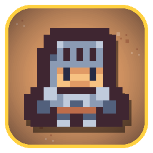
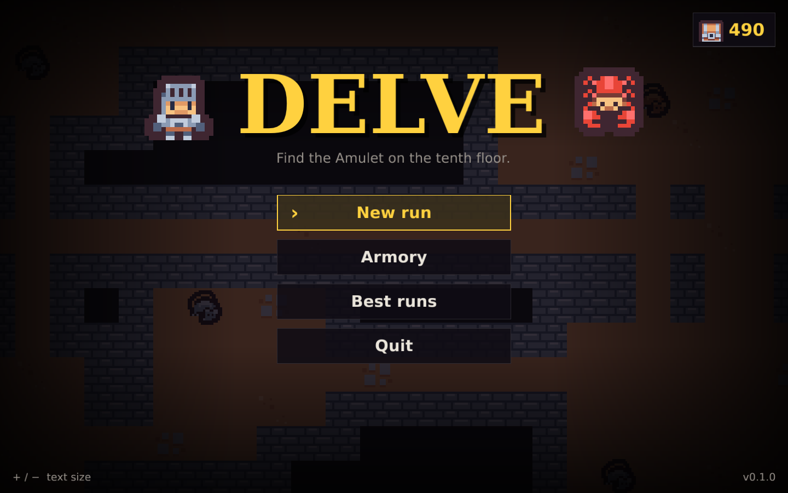
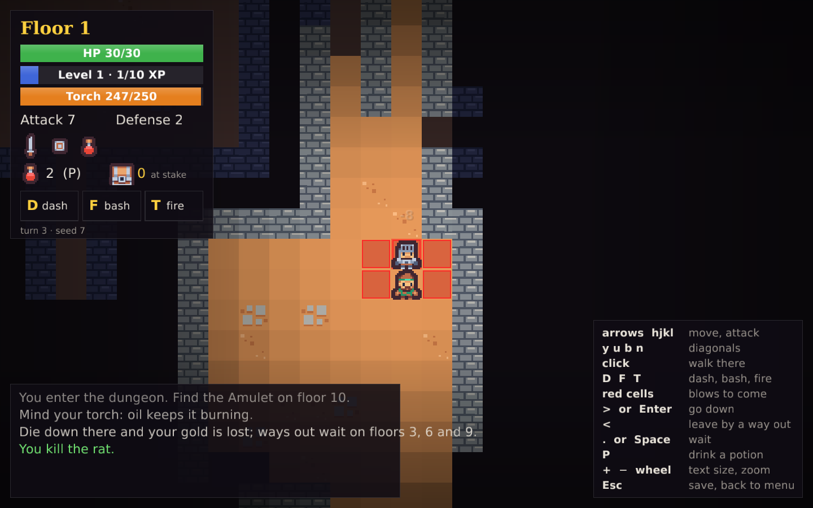
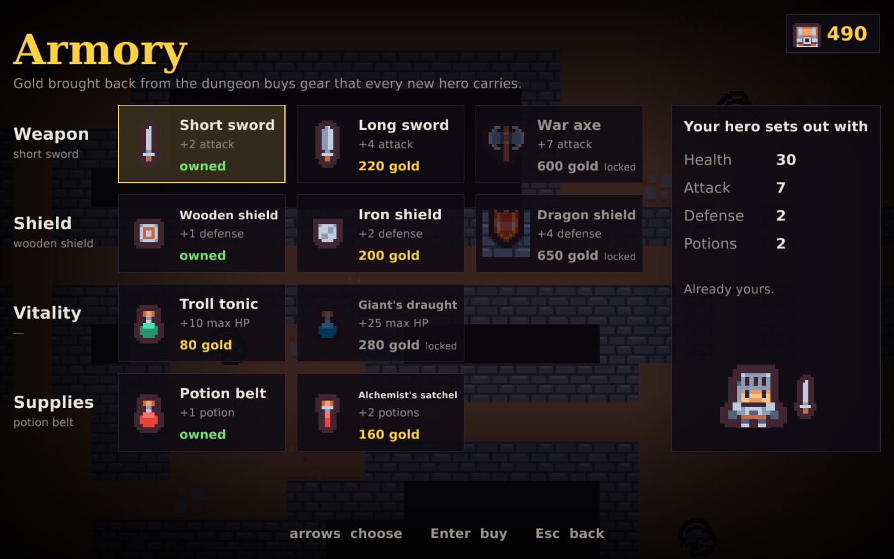

<div align="center">



# delve

**A small roguelike about light, gold, and knowing when to leave.**

[](LICENSE)



</div>

---

Go down ten floors of a dungeon and seize the Amulet. Your torch is burning out,
the monsters show you exactly where they will strike, and every coin you carry is
lost if you die down there.

## What makes it different

- **Your torch is a resource.** It burns down every turn and lights less and less
  as it goes. Flasks of oil feed it. When it dies you see only the cells next to
  you, and shades start rising from the dark.
- **Monsters show their next blow.** Each one marks in red the cells it is about to
  hit, and strikes on the following turn: step out of it, kill it first, or knock it
  off balance. Every kind has its own shape: a rat bites, a goblin lunges two cells,
  an orc sweeps, a troll smashes everything around it, a wraith fires a bolt down a
  line, a demon throws fire from afar.
- **Three abilities** with cooldowns: **dash** two cells, **shield bash** a monster
  into a wall (or into another monster), **throw fire** from your torch at the cost
  of some of its light.
- **Push your luck.** Floors 3, 6 and 9 hold a way out. Leave, and the gold you
  found goes to your purse. Die, and it is lost.
- **An armory between runs.** Gold brought back buys equipment that every new hero
  starts with: weapons, shields, tonics, potion belts.
- **Roguelike saves.** Quitting saves the run; loading it deletes the save. Death
  is final.

<p align="center">
  
  
</p>

## Install

You need [Rust](https://rustup.rs). On Linux:

```sh
git clone https://github.com/GoathierS/delve
cd delve
./install.sh
```

This builds the game, installs it in `~/.local/bin` and adds **delve** to your
applications menu. `./install.sh --remove` uninstalls it (your saves and gold
stay).

Or just run it from the source tree:

```sh
cargo run --release --bin delve        # the graphical game
cargo run --release --bin delve-term   # the same game in a terminal
```

## Controls

| Key | Action |
|---|---|
| arrows, `hjkl`, `yubn` | move, attack |
| click | walk there |
| `D` `F` `T`, then a direction | dash, shield bash, throw fire |
| `>` or Enter | go down the stairs |
| `<` or Enter | leave by a way out |
| `.` or Space | wait |
| `P` | drink a potion |
| `+` `−`, mouse wheel | interface size, zoom |
| Esc | save and go back to the menu |

The terminal version uses the same keys, in lowercase.

## Layout

- `crates/core`: the rules, dungeon generation and saves, without any display.
- `crates/gui`: the graphical game, with [macroquad](https://macroquad.rs).
- `crates/term`: the terminal game, with [ratatui](https://ratatui.rs).

Saves live in `~/.local/share/delve` on Linux, `%APPDATA%\delve` on Windows and
`~/Library/Application Support/delve` on macOS.

## Credits

- Tiles: [Tiny Dungeon](https://kenney.nl/assets/tiny-dungeon) by Kenney (CC0).
- Fonts: [DejaVu](https://dejavu-fonts.github.io/) (Bitstream Vera license).

## License

GPL-3.0-or-later. See [LICENSE](LICENSE).
